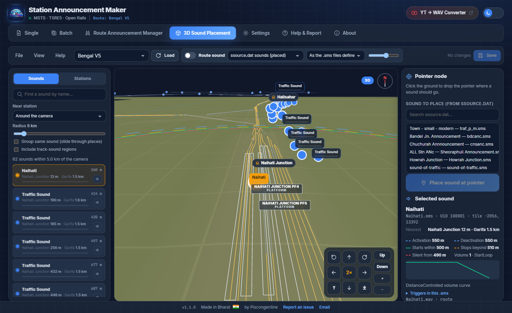
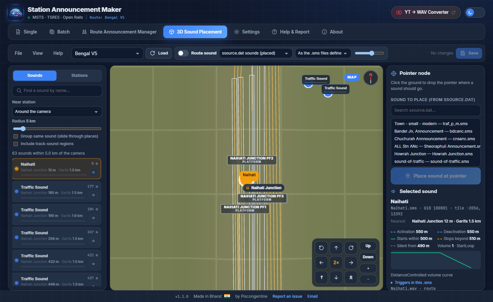
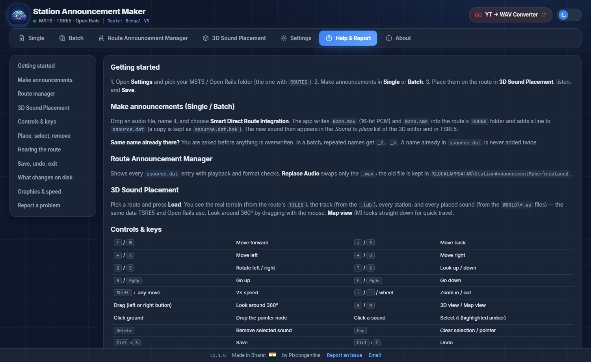
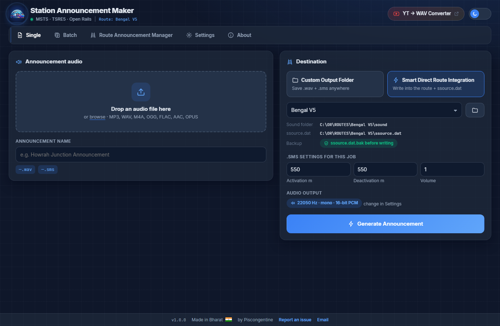
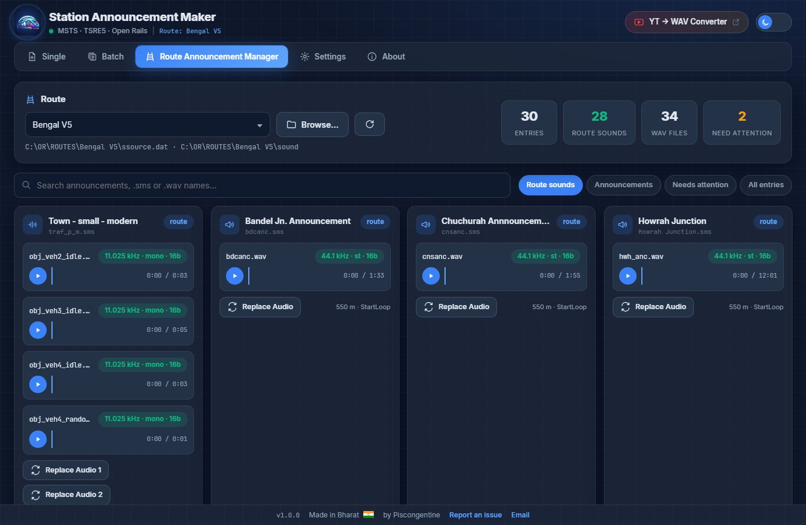
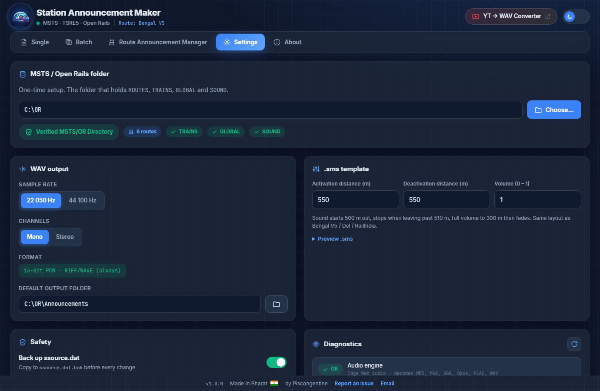
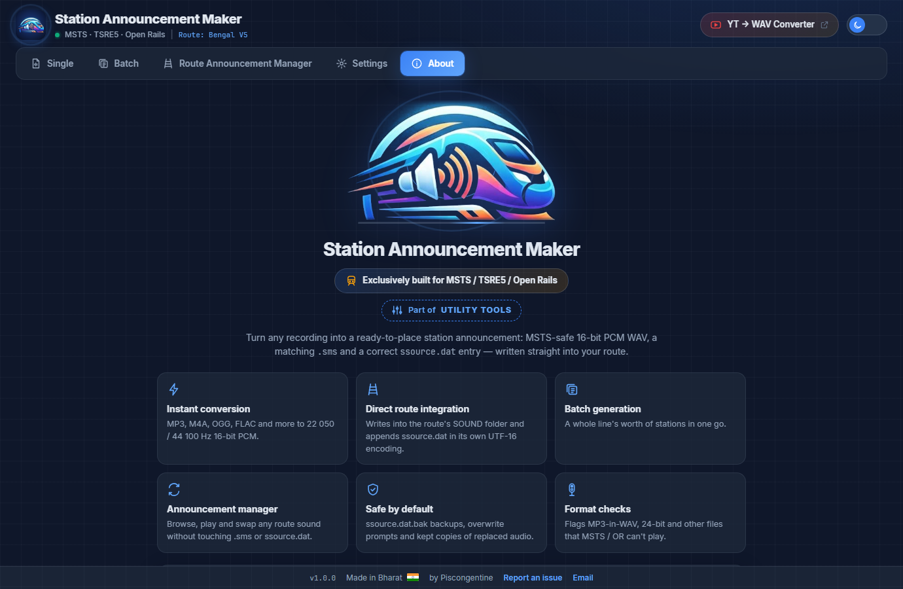

<p align="center">
  
</p>

<p align="center">
  <a href="https://github.com/piscongentine/station-announcement-maker/releases/latest/download/Station-Announcement-Maker-Setup.exe"></a>
</p>

<p align="center">
  <a href="https://github.com/piscongentine/station-announcement-maker/releases/latest"></a>
  <a href="CHANGELOG.md"></a>
  
  
  
</p>

<p align="center">
  <a href="CHANGELOG.md"><b>📋 Update log</b></a> ·
  <a href="https://github.com/piscongentine/station-announcement-maker/releases"><b>📦 All releases</b></a> ·
  <a href="https://github.com/piscongentine/station-announcement-maker/issues/new/choose"><b>🐞 Report an issue</b></a> ·
  <a href="mailto:shwetpurwar0911@gmail.com?subject=Station%20Announcement%20Maker%20-%20issue%20report&body=Describe%20the%20problem%3A%0A%0ASteps%20to%20reproduce%3A%0A1.%20%0A2.%20%0A%0AApp%20version%20(About%20tab)%3A%20%0AWindows%20version%3A%20"><b>✉️ Email the developer</b></a>
</p>

<p align="center"><b>Record it. Drop it. Hear it at the platform.</b><br>
Turn any recording into a ready-to-place station announcement for MSTS, TSRE5 and Open Rails:<br>
a 16-bit PCM WAV, a matching <code>.sms</code> and the <code>ssource.dat</code> entry, written straight into your route.</p>

---

<p align="center">
  
  
  
  
  
  
  
</p>

## ⬇️ Install

1. Download **[Station-Announcement-Maker-Setup.exe](https://github.com/piscongentine/station-announcement-maker/releases/latest/download/Station-Announcement-Maker-Setup.exe)**. This link always gets the latest version.
2. Run it. Setup checks this PC with an animated system check:
   - Windows 10/11;
   - Microsoft Edge;
   - Python 3 with Tk;
   - screen and sound output;
   - your MSTS / Open Rails folder.
3. Anything missing is installed for you. If Python isn't there, Setup downloads the official **Python 3.14.6** from python.org, checks its Python Software Foundation signature and installs it for your user account only. No administrator rights are needed.
4. Start the app and pick your MSTS / Open Rails folder once.

Setup updates an installed copy in place and keeps your settings. Older versions stay downloadable in the **[update log](CHANGELOG.md)**.

## 🆕 What's new in 1.1: 3D Sound Placement

- 🚉 **1.1.1:** platforms are drawn as empty boxes and labelled like the Track Viewer (**NAIHATI JUNCTION PF1 · PLATFORM**). Labels no longer overlap.

- 🧭 **The route in 3D, 360°.** Real terrain, track, stations and every placed sound, read from the route's own files.
  - Fly with ↑ ↓ ← → (Shift = 2×), rotate with Q/E, go up and down with R/F, zoom with +/−.
  - An on-screen pad does the same, and Map view (M) gives a top-down view.
- 📍 **Pointer node and place / select / remove.** Click the ground, pick an `ssource.dat` sound, place it.
  - Select by click or by name; the selection turns amber.
  - Saving writes the same `.ws` format TSRE5 uses, with backups.
- 🔊 **Hear the route.** Choose ssource.dat sounds, `ttype.dat` track sounds or all of them, played the way each `.sms` defines:
  - Activation and Deactivation distances;
  - distance and speed triggers;
  - volume curves;
  - 3D direction.

  A train-speed slider plays the speed-controlled track sounds.
- 🎚 **Sound bars** with live levels, nearest stations, on/off buttons, a slider through every place a sound is used, and a near-station / radius filter.
- ❓ **Help & Report tab**, File / View / Help menus, and an Open in TSRE5 option.
- 🖥 **Graphics check.** The dedicated GPU is used when it has a driver; otherwise the integrated chip.

Full details and a download link for every version: **[Update log](CHANGELOG.md)**.

## ✨ Features

| | |
|---|---|
| 🎙 **Single** | Drop or browse one recording. MP3, M4A, OGG, FLAC and WAV are converted in the background to 22 050 / 44 100 Hz 16-bit PCM, with a live badge and a waveform player. The announcement name becomes safe `.wav` / `.sms` file names. |
| 📚 **Batch** | Drop many files at once. You get an animated queue with name fields, play/pause and remove, then **Generate All** with a progress bar. |
| 🚉 **Smart Direct Route Integration** | Writes the `.wav` and `.sms` into the route's `SOUND` folder and appends `ssource.dat` in its own UTF-16 encoding. It backs up to `ssource.dat.bak` first, then shows an animated summary of every file it made. |
| 🗂 **Route Announcement Manager** | Shows every `ssource.dat` entry of a route as a searchable card with playback. **Replace Audio** swaps one `.wav` and leaves `.sms` and `ssource.dat` untouched. It also flags MP3-in-WAV, 24-bit and missing files. |
| 🛡 **Safe by default** | Never overwrites without asking. Duplicate names in a batch get `_2`, `_3`; nothing is added to `ssource.dat` twice. Replaced audio is kept. |
| ⚙️ **Settings** | Verified MSTS/OR folder, WAV and `.sms` defaults, backup toggle, diagnostics, Dark / Light / System theme and Full / Reduced motion. |
| 🧭 **3D Sound Placement** | The route in 3D or Map view, with stations, track and sounds. Includes the pointer node; place / select / remove / undo / save; radius rings from each `.sms`; sound bars; and the near-station filter. |
| 🔊 **Hear the route** | ssource.dat, ttype.dat or all sounds, played by each `.sms`'s activation distances, triggers, curves and volume, in 3D. Track sounds get a train-speed slider. |
| 🔗 **YT → WAV** | One click opens audioforges.com to grab a WAV from a video you're allowed to use. |

## 🐞 Report an issue

- **On GitHub:** **[open an issue](https://github.com/piscongentine/station-announcement-maker/issues/new/choose)** and pick *Bug report* or *Feature request*.
- **By email:** **[one-click email to shwetpurwar0911@gmail.com](mailto:shwetpurwar0911@gmail.com?subject=Station%20Announcement%20Maker%20-%20issue%20report&body=Describe%20the%20problem%3A%0A%0ASteps%20to%20reproduce%3A%0A1.%20%0A2.%20%0A%0AApp%20version%20(About%20tab)%3A%20%0AWindows%20version%3A%20)**.
- **From inside the app:** open the **About** tab and choose **Report on GitHub** or **Email the developer**. The email opens with the app version, Windows and Python versions filled in. The footer has the same two links.

## 🔧 What gets written

Everything below copies the format of real Indian routes (Bengal V5, Del, RailIndia).

- **`<route>\SOUND\Name.wav`:** RIFF/WAVE, `WAVE_FORMAT_PCM`, 16-bit.
- **`<route>\SOUND\Name.sms`:** UTF-16 LE with BOM, CRLF. It is byte for byte the layout of Bengal V5's `Bandel.sms`:
  - `ScalabiltyGroup( 3`;
  - Activation / Deactivation `Distance`;
  - a `StartLoop` stream with `Distance_Dec_Past` / `Distance_Inc_Past` triggers;
  - a distance `VolumeCurve`.
- **`<route>\ssource.dat`:** one line is appended, in the file's own encoding. There is no entry count to fix.
  ```
  Sound  ( Name ( "Howrah Junction Platform 9" )	FileName ( "Howrah_Junction_Platform_9.sms" )	)
  ```

**Placing sounds:** use the **3D Sound Placement** tab. It writes the sound into `<route>\WORLD\w-XXXXXX+ZZZZZZ.ws` as `Soundsource ( Position ( x y z ) FileName ( name.sms ) UiD ( n ) )`, the same way TSRE5 does, with the next free UiD for that tile. Every other object in the file is kept as it was. You can also place sounds in TSRE5 itself: open the route, choose *Sound sources*, pick the name and place it.

## 🧱 Build from source

The app has no build step: it is Python standard library plus HTML/JS, shown in an Edge app window.

| Command | What it builds |
|---|---|
| `build.ps1 [-Shortcut]` | The launcher `.exe`, using the C# compiler built into Windows |
| `build-setup.ps1` | The installer. Needs Inno Setup 6.7 and Pillow. |
| `python tests\test_mstsfiles.py` | Runs the file-format tests |

## 📜 Licence

**[Station Announcement Maker Licence](LICENSE.txt)**. It uses the same terms as Loco Tester:
- free to use, share and modify;
- keep the credit;
- don't claim it as your own;
- rename modified versions;
- no selling.

The bundled Inter and JetBrains Mono fonts are under the SIL Open Font License.

<p align="center"><sub>Part of <b>UTILITY TOOLS</b> · by <b>Piscongentine</b> · Made in Bharat 🇮🇳</sub></p>
